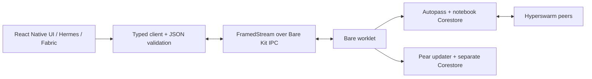

# Architecture notes (`src/`, `workers/`, bundling)

> Read before editing `src/`, `workers/` or `index.ts`, or when debugging worklet
> startup, IPC or bundling. Only non-obvious, code-verified facts — the code is the
> reference for everything else. Index: [AGENTS.md](../AGENTS.md).

React Native screens (`src/App.tsx`, sharing/handoff/activity components) →
`src/useNotebook.ts` (one mounted controller, coalesced entry snapshots) → one app-lifetime client (`src/worker/runtime.ts`)
↔ `FramedStream` over BareKit IPC ↔ Bare worker (`workers/main.js`: copied updater
scaffolding plus an isolated Autopass notebook). The code is small — read it for the wiring; below are only the non-obvious
facts.

- **Two packages expose a `PearRuntime`, and they are not interchangeable.**
  `pear-mobile` has an `exports` condition map: React Native resolves to
  `react-native.js` (a **static** `PearRuntime.run(filename, bundle, argv)` that starts a
  Worklet and returns its IPC), while Bare resolves to `bare.js` (the updater/storage
  class). `pear-runtime-react-native` also ships a runtime class, but its `run` is an
  **instance** method (`new PearRuntime().run(...)`). This project uses `pear-mobile`
  for the runtime and uses `pear-runtime-react-native` as an Expo config plugin,
  never as a runtime import. Metro merges React Native and Expo defaults.
- **The `.bundle` extension in `'/worker.bundle'` is load-bearing, and it is Bare that
  requires it, not BareKit.** `Worklet.start()` only type-checks the filename and
  forwards it to the native `startBytes`/`startUTF8`; it never inspects the extension.
  The Bare runtime embedded in BareKit resolves `.bundle` as a Bare bundle rather than
  as plain JavaScript (BareKit's own default worklet name is `bare:/worklet.bundle`).
  The string is an identity, not a path on disk — the bytes come from the imported
  `src/worker.bundle.js`.
- **The IPC duplex emits plain `Uint8Array`, not Buffers** (`BareKitIPC._read` does
  `this.push(new Uint8Array(data))`). `data.toString()` on the React Native side yields
  a comma-joined byte list, not text — decode with `b4a.toString(data)`. In React
  Native, `b4a` resolves through its `"react-native"` export condition to
  `react-native.js`, which falls back to the pure-JS `browser.js` because
  `react-native-b4a` is not installed. `FramedStream` itself needs no mobile variant: it
  only depends on `streamx` and `b4a`, and the BareKit IPC object already is a `streamx`
  Duplex.
- `workers/main.js` copies installed `hello-pear-worker` 1.1.0 and directly requires
  `pear-mobile`. Copying loses the package's mobile import remap, so retaining the
  desktop `pear-runtime` require would be incorrect. Its direct dependencies are
  declared at the original lockfile versions.
- `workers/library.js` selects one active store using `relay/active.json`. It adopts
  the Phase 2 `relay/notebook` directory in place, creates fresh `notebooks/<id>`
  stores, and uses a fresh `joins/<id>` directory for every attempt. Existing active
  stores cannot be replaced by Create/Join. Autopass remains in `workers/notebook.js`,
  separate from the updater store. See `docs/PHASE3.md` for activation/cancellation.
  Startup awaits `pass.ready()`. Requests are validated in `shared/protocol.js` and
  dispatched by `workers/requests.js`; mutations and list snapshots are serialized.
  `get()` returns `{ value, file }` or null. Notebook refresh uses the isolated
  `workers/record-snapshot.js` adapter: a single `pass.base.view.snapshot()` and
  `for await` scans of the `ack:` and `entry:` key ranges. Autopass 3.4.1 ignores
  `list(opts)`, so unrestricted listing would decode inline attachment files.
  The adapter relies on pinned HyperDB 4.22.3 internals, closes snapshots on early
  return/failure, and has no unrestricted fallback. It excludes separate attachment
  keys; it cannot avoid decoding a file improperly embedded in an entry/ack record.
- Acknowledgments are separate `ack:<entry-id>:<writer-key>` records. Bare derives the
  local key and rejects Viewer writes. The single entry snapshot includes validated
  acknowledgments/local key; existing update refreshes cover both record kinds.
  Deleted-entry acknowledgments are retained but hidden. Shared Autopass writers
  can overwrite each other's keys, so these are record claims, not authenticated
  receipts. See `docs/PHASE4.md` before changing handoff semantics.
- `bare-pack` runs with `--linked` and four `--host` targets, so native addons resolve
  to `linked:` specifiers that `react-native-bare-kit` has prelinked as xcframeworks /
  `.so`s. Adding a worker dependency with a native addon that BareKit does not already
  vendor will bundle fine and then fail to link at runtime.
- `src/activity.js` projects the existing current entry/acknowledgment snapshot into
  activity rows; it stores no event history and adds no worker subscription or IPC
  operation. Orphans disappear with their entries. Device timestamps determine display
  order only. `NotebookActivity.tsx` virtualizes those rows and keeps row props scalar;
  filter state lives above the keyed screen so detail/back preserves the filter.
- Android top padding is refreshed after root layout from RN's existing
  `StatusBarManager` TurboModule. `StatusBar.currentHeight` is cached at import time
  and can be zero before native window insets exist on a cold release launch. This
  is platform-module use, not a custom native module; no native dependency changed.
- Screen presentation is keyed by route to reset scroll/press state. The controller
  stays mounted above that subtree; navigation does not create a worklet or replace
  the FramedStream. UI mutations use a synchronous ref guard in addition to disabled
  controls; worker validation/permissions remain authoritative.
- Worklets are **suspended and resumed with the app**: `react-native-bare-kit` registers
  a global `AppState` listener that calls `suspend()` on `background` and `resume()` on
  `active` for every live worklet. Backgrounded P2P work stops; do not assume the swarm
  keeps replicating while the app is not foregrounded.
- `PearRuntime.run()` exposes only IPC, not a Worklet handle. The application-lifetime
  session is retained on `globalThis` to prevent a second worker on component remount
  or Fast Refresh. Screen cleanup removes subscriptions/refresher callbacks, not the
  shared pipe. Disconnection rejects pending requests and requires a full app restart;
  never spawn a replacement worker against a store whose owner may still be alive.
- Pipe close/graceful goodbye invoke idempotent worker cleanup, close Autopass and its
  Corestore, and preserve cleanup of the template updater/swarm/store. Forced OS
  termination cannot guarantee JS cleanup; restart persistence must be tested.
- Pear control strings remain separate from JSON application frames on the same pipe.
  The client correlates IDs, validates results, bounds waits, and coalesces list refreshes.
  Background events use `invalidate()` without allocating waiting callers. An explicit
  `refresh()` waits for a read started after that call; subsequent invalidations cannot
  extend its wait until global quiet. There is still only one active read, with at most
  one pending waiter batch for the following read. Closing rejects waiting callers and
  suppresses callbacks from a late response. A failed reconciliation read does not undo
  a locally completed mutation.
  JSON application messages retain the 2M UTF-16-code-unit ceiling and also have a
  4,600,000-byte UTF-8 ceiling. The latter preserves the 1.5M-character normalized
  snapshot allowance at worst-case UTF-8 width plus envelope overhead. It is not a
  new lower notebook quota. Both senders validate before IPC; receivers validate before
  JSON parsing. FramedStream/native buffers already exist by receive time, so this
  does not claim protection against a compromised raw IPC writer's frame allocation.
  Foreign stored values use the same parse budget and are counted as skipped without
  deleting data. Unencodable responses become correlated `RESPONSE_UNAVAILABLE`
  failures: the operation may already have completed and must not be replayed.
  An Autopass `update` is a local-view change, never a remote delivery acknowledgment.
  See `docs/PHASE2.md` for schemas, limits, and actual runtime evidence.
- `console.log` inside the worklet does not reach the Metro console — BareKit writes it
  to the system log (on this emulator the process tag is `pearreactnative`; also check `bare`): `xcrun simctl spawn booted log stream` on iOS,
  `adb logcat` on Android. A worker that dies at boot therefore looks like a UI that
  simply never updates.
- **A stall is usually the network, not the code, and the two look identical.** An
  update that never arrives most often means the machine seeding it is unreachable:
  `pear seed <link> --json` prints `firewalled` and `natType`, and `natType: "Random"`
  is symmetric NAT, which defeats holepunching. Mobile networks make this more likely,
  not less. Before debugging app logic, confirm replication works at all.

## Native execution and profiling boundaries

The pinned Android build uses React Native 0.83.2 / Expo 55.0.29. Generated
`android/gradle.properties` has `newArchEnabled=true` and `hermesEnabled=true`;
`MainActivity.kt` uses the default Fabric delegate. These generated files are
inspection evidence, not files to edit or commit. Configuration flows through Expo
and the pinned plugin. Fabric renders native views; it does not eliminate React
render work, JSON parsing or text-layout costs.

Bare Kit 0.12.3 declares `codegenConfig` and a `NativeBareKit` TurboModule spec, loaded
with `TurboModuleRegistry.getEnforcing('BareKit')`. Its C++ module uses React Native JSI and a
call invoker to access the Bare worklet/IPC. This is dependency-provided integration:
Relay has no handwritten TurboModule, custom Fabric component or custom JSI bridge.
The Pear plugin also generates the native Expo reload module. Both integrations are
provided by dependencies rather than custom native modules in Relay.

The React Native UI runs in Hermes; Autopass runs in a distinct Bare runtime/worklet.
They live within the same application process, not separate OS security sandboxes.
A native assertion or addon crash can terminate the entire process. A controlled
worklet termination can close IPC while RN survives; these are different failure
modes. Native `read()` explicitly copies IPC bytes into a JSI ArrayBuffer. Neither
zero-copy transfer nor automatic off-thread JSON parsing is claimed.

Native packages are autolinked/code-generated; Bare Kit's CMake and addon packaging
supply the prelinked native libraries used by `bare-pack --linked`. Matching JS
package versions to those binaries remains essential. Android ARM64 is the verified
runtime target; producing other ABI artifacts does not prove those ABIs work.

Debug gets RN JavaScript from Metro, sends the updater flag `false`, and bypasses
native OTA bundle selection. Standalone release embeds RN JavaScript, sends `true`,
and uses the plugin's native manifest/version check for optional OTA selection.
No actual OTA deployment/apply is verified by local build success. Phase 7 changes
neither update timing nor native identity, dependencies or generated native code.

Inspection points after `npm ci`: `react-native-bare-kit/specs/NativeBareKit.ts`,
`react-native-bare-kit/shared/BareKitModule.cc` (`read()`), its `package.json`
`codegenConfig`, and `android/CMakeLists.txt` under `node_modules/`. Relay's runtime
entry is `src/worker/runtime.ts`; the copied Pear lifecycle and application service
are in `workers/main.js`. Generated Android properties/delegates and the release
APK library list were inspected directly; they are not substitute source files.

Profile release for user-visible timings. React DevTools/debug instrumentation can
explain commits and subscriptions, but its timings are not release benchmarks.
Keep UI/main-thread frame measurements distinct from RN JS work, Bare work, and
whole-process PSS (which includes both runtimes and native memory). See
[Phase 7 measurements](../docs/PHASE7.md) for executed results and limitations.

## Attachment feasibility diagnostics

`scripts/probes/staging-rn.js` is an explicit Metro diagnostic entry, never imported
by Relay. It invokes the existing native Expo `FileSystem` module and starts a
separate probe worklet with no notebook/Corestore access. `workers/file-staging.js`
limits input to 1 MiB, accepts only live random handles, verifies BLAKE2b-256 and
uses fixed filenames in owner-accessible private cache slots. The probe transfers
handles/digests over JSON IPC, not file contents. It closes the probe and removes
slots on normal completion/failure. Forced termination can leave cache files;
production expiry/recovery and document-provider access are Phase 11B work.

This demonstrates same-app filesystem interoperability, not an OS security boundary
between RN and Bare. No product attachment schema, operations, UI or dependencies
are introduced. See [Phase 11A](../docs/PHASE11A.md) for reproduction and limits.
